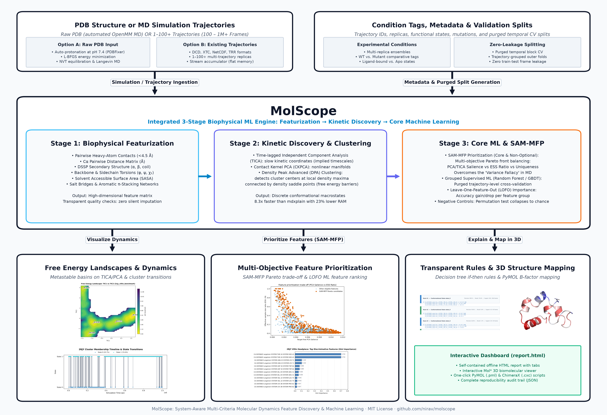

# MolScope: System-Aware Molecular Dynamics Feature Discovery & Core Machine Learning

[-10b981.svg)](https://github.com/N-S8990/molscope)
[](https://www.python.org/downloads/)
[](https://opensource.org/licenses/MIT)
[](https://github.com/N-S8990/molscope)

MolScope is an end-to-end Python platform for Molecular Dynamics (MD) simulation, multi-family biophysical featurization, non-parametric conformational state discovery, and statistically rigorous Machine Learning feature prioritization (**SAM-MFP**).

---

## Graphical Abstract



*Figure 1: The MolScope 3-Stage Architecture. (Top) Flexible input: raw PDB structures (automated OpenMM simulation) or existing multi-replica MD trajectories with zero-leakage cross-validation splits. (Middle) Integrated engine: multi-family biophysical featurization, non-parametric kinetic discovery (TICA, CKPCA, DPA clustering), and core statistical ML with SAM-MFP Pareto prioritization. (Bottom) Actionable outputs: 2D Free Energy Landscapes, SAM-MFP Pareto trade-off curves, transparent decision rules, 3D PyMOL B-factor mapping, and an interactive HTML report dashboard.*

---

## Core Platform Capabilities

MolScope integrates the entire continuum of molecular dynamics analysis—from raw crystal structures to statistical machine learning and 3D structural interpretation—into a unified, reproducible framework.

```text
[Structure Ingestion]        [Kinetic Manifold]              [Statistical ML]              [Interpretation]
Raw PDB / Trajectory   ──►   TICA / CKPCA / DPA        ──►   LOFO Classifiers        ──►   3D PDB B-Factors
Multi-Family Features        Free Energy Landscape           SAM-MFP Pareto Front          Interactive Dashboard
```

| Capability | Platform Architecture & Scientific Rigor |
| :--- | :--- |
| **Native 3-Stage Pipeline (`molscope run-pdb`)** | Takes raw PDB files or AlphaFold models and executes automated protonation (pH 7.4), energy minimization, NVT thermal equilibration, and Langevin dynamics (Amber14-SB + GBN2 implicit solvent), feeding directly into downstream kinetic clustering and ML. Also ingests existing multi-replica trajectories (DCD, XTC, TRR, NetCDF). |
| **Multi-Family Biophysical Featurization** | Extracts **12+ biophysical feature families**: pairwise residue contacts, full Cα distance matrices, DSSP secondary structure fractions ($\alpha$-helix, $\beta$-sheet, coil), backbone/sidechain torsions ($\phi, \psi, \chi_1$), solvent-accessible surface area (SASA), salt-bridge distances, and aromatic $\pi$-stacking geometries. |
| **Variational Kinetics & Non-Parametric Clustering** | Projects high-dimensional feature spaces onto variational TICA and Contact-KPCA manifolds. Uses **Density Peak Advanced (DPA)** to cluster free energy basins and barrier saddle points without requiring an arbitrary pre-selected number of clusters ($k$). |
| **Mandatory Statistical Machine Learning** | Fits regularized supervised models (Random Forest, Gradient Boosted Trees, Logistic Regression) with Leave-One-Feature-Out (LOFO) ablation to quantify exact feature impact. Prevents data leakage via purged temporal block CV and trajectory-grouped splits. |
| **SAM-MFP Multi-Objective Prioritization** | Formulates feature discovery as a multi-criteria Pareto optimization ($\text{Salience} \times \text{ESS Ratio} \times \text{Uniqueness} \times \text{Consistency}$). Solves the **Variance Fallacy** by penalizing slow autocorrelated noise and redundant feature collinearity. |
| **Direct 3D Hotspot Mapping on PDB B-Factors** | Automatically maps residue-level ML importance scores directly into the crystallographic B-factor field of a prepared PDB file. Generates ready-to-run PyMOL (`.pml`) and ChimeraX (`.cxc`) scripts for instant 3D visualization. |
| **Interactive Standalone Dashboard (`report.html`)** | Builds an offline, self-contained HTML dashboard with interactive tabs, 2D Free Energy Landscapes, timeline cluster transitions, Boolean decision-tree rule cards, and complete diagnostic figures. |

---

## The 3-Stage Pipeline

```text
[Stage 1: PDB Input & OpenMM MD Simulation]
Raw PDB Structure ──► PDBFixer (pH 7.4) ──► Amber14-SB + GBN2 Implicit Solvent ──► Langevin MD (DCD)
                                     OR Direct Trajectory Ingestion (1–100+ Replicas)
                                            │
                                            ▼
[Stage 2: Multi-Family Featurization & Kinetic Discovery]
Feature Extraction (Contacts, Cα Distances, DSSP, Dihedrals, SASA, Salt Bridges)
    ──► Variational TICA & Contact Kernel PCA (CKPCA)
    ──► Density Peak Advanced (DPA) Clustering ──► Discrete Metastable Macrostates (S₁..Sk)
                                            │
                                            ▼
[Stage 3: Core Statistical ML & SAM-MFP Feature Prioritization]
SAM-MFP Multi-Objective Pareto Discovery (PCA Salience vs. ESS Ratio vs. Uniqueness)
    ──► Purged Trajectory-Grouped Supervised ML (Random Forest / GBDT)
    ──► Leave-One-Feature-Out (LOFO) Feature Ranking & Permutation Negative Controls
    ──► 3D B-Factor PDB Mapping + Decision Tree Rule Cards + report.html Dashboard
```

---

## Installation

MolScope requires Python 3.10 or newer.

```bash
# Clone the repository
git clone https://github.com/N-S8990/molscope.git
cd molscope

# Create and activate virtual environment
python -m venv .venv
source .venv/bin/activate
pip install --upgrade pip

# Install MolScope with test, simulation, and visualization dependencies
pip install -e '.[test,simulation]'
```

Verify installation:
```bash
molscope --help
```

---

## Quickstart: 3 Ways to Run

### Method 1: The Single-Command 3-Stage PDB Runner (`molscope run-pdb`)

Take any crystal structure or AlphaFold PDB, simulate it with OpenMM, discover conformational states, and rank all molecular features:

```bash
molscope run-pdb \
  --pdb path/to/protein.pdb \
  --out-dir results/my_run \
  --steps 50000 \
  --report-interval 500 \
  --temperature 300.0 \
  --ph 7.4 \
  --states 2
```

**What happens automatically:**
1. **Stage 1 (Simulation):** Strips crystallographic artifacts, adds missing heavy atoms and hydrogens at pH 7.4, runs 500 L-BFGS minimization steps, 1,000 NVT equilibration steps, and integrates 100 ps of Langevin dynamics (Amber14-SB + GBN2 implicit solvent).
2. **Stage 2 (Clustering):** Extracts biophysical features, projects onto PCA/TICA, and clusters frames into macrostates via DPA.
3. **Stage 3 (Machine Learning):** Fits regularized ML models, performs LOFO ablation across all features, maps residue importances to PDB B-factors, and builds `report.html`.

---

### Method 2: High-Level Python API (`from molscope.api import Study`)

For interactive Jupyter notebooks or Python scripts with existing trajectories:

```python
from molscope.api import Study

# 1. Initialize study with on-the-fly PBC imaging
study = Study(project_id="villin_study", out_dir="results/villin")
study.add_system(
    system_id="villin_headpiece",
    topology="data/protein.pdb",
    trajectories=["data/trajectory.xtc"],
)
study.configure_imaging(unwrap=True, center_selection="protein", wrap=False)

# 2. Configure feature families
study.configure_features([
    "protein.ca_distances_contacts",
    "protein.secondary_structure_dssp",
    "protein.sidechain_torsions",
    "protein.salt_bridges",
])
study.run(extract_only=True)

# 3. Kinetic & Non-Linear Dimensionality Reduction
tica_res = study.run_tica(lag_time=2, components=5)
ckpca_res = study.run_contact_kpca(n_components=5)

# 4. State Discovery & Clustering
dpa_res = study.cluster_dpa(coordinate_name="TICA")

# 5. Free Energy Landscape & 3D Visualization Export
study.plot_free_energy_landscape(dim1="TIC1", dim2="TIC2", temperature_k=300.0)
study.explain_clusters(max_depth=3)
study.export_3d(out_dir="results/villin/3d_visualization")
```

---

### Method 3: Configurable Multi-Replica Project (`project.json`)

For large multi-trajectory cohorts with condition comparisons:

```bash
# Run full project pipeline
molscope run --project project.json --out-dir results/cohort_run
```

---

## Interactive Jupyter Notebooks

MolScope provides a dedicated suite of hands-on Jupyter tutorial notebooks in [`notebooks/`](notebooks/):

| Notebook | Focus Area | Description |
| :--- | :--- | :--- |
| **[`01_Quickstart_Villin_Headpiece.ipynb`](notebooks/01_Quickstart_Villin_Headpiece.ipynb)** | **End-to-End Workflow** | Interactive tour using the `Study` API on HP35 Villin Headpiece (2RJY): multi-family featurization, TICA, CKPCA, DPA state discovery, 2D Free Energy Landscapes ($\Delta G$ in kcal/mol), Boolean decision tree rules, and 3D PyMOL export. |
| **[`02_Simulation_to_Discovery_Pipeline.ipynb`](notebooks/02_Simulation_to_Discovery_Pipeline.ipynb)** | **Automated OpenMM Continuum** | 3-stage simulation pipeline (`molscope run-pdb`): raw PDB preparation at pH 7.4, Amber14-SB + GBN2 implicit solvent, dry-run frame/byte estimates, checkpoint recovery, and seamless handoff into ML discovery. |
| **[`03_Statistical_ML_and_SAM_MFP_Rigor.ipynb`](notebooks/03_Statistical_ML_and_SAM_MFP_Rigor.ipynb)** | **Statistical ML & Rigor** | Overcoming the "Variance Fallacy", multi-objective Pareto optimization (representation salience vs. ESS ratio vs. uniqueness), purged block cross-validation with temporal embargo buffers, and Leave-One-Feature-Out (LOFO) predictive ranking. |
| **[`04_Multi_Family_Biophysical_Featurization.ipynb`](notebooks/04_Multi_Family_Biophysical_Featurization.ipynb)** | **12+ Feature Families** | Deep dive beyond pairwise contacts: Cα distance graphs, DSSP helix/sheet/coil fractions, circular dihedrals ($\phi, \psi, \chi_1$), FreeSASA solvent exposure, salt-bridge geometry, and aromatic $\pi$-stacking. |
| **[`05_Physical_Correctness_and_PBC_Imaging.ipynb`](notebooks/05_Physical_Correctness_and_PBC_Imaging.ipynb)** | **Input Checks & PBC Imaging** | Pre-flight trajectory validation, missing atom/residue detection, unwrapped coordinate jump diagnosis, on-the-fly PBC imaging modes (`auto`, `center_and_wrap`, `no_wrap`), unit cell box verification, and structural profiling. |
| **[`06_Large_Scale_Streaming_Analysis.ipynb`](notebooks/06_Large_Scale_Streaming_Analysis.ipynb)** | **Out-of-Core Streaming** | Constant-memory trajectory extraction, out-of-core chunked featurization, columnar Parquet persistence, streaming statistics aggregation, memory profiling, and linear scaling over multi-gigabyte trajectories. |
| **[`07_ML_Validation_and_Leakage_Prevention.ipynb`](notebooks/07_ML_Validation_and_Leakage_Prevention.ipynb)** | **Leakage-Free Statistical ML** | Autocorrelation time ($\tau_{int}$) estimation, purged temporal block cross-validation, temporal embargo buffers, preventing optimistic data leakage, block permutation null controls, and simulation convergence checks. |
| **[`08_Configurable_Projects_and_Study_Workspaces.ipynb`](notebooks/08_Configurable_Projects_and_Study_Workspaces.ipynb)** | **Declarative Workspaces & Studies** | Production workspace initialization (`initialize_study`), declarative `project.json` schema configuration, run lifecycle management (`begin_run`), run provenance tracking, and reproducible artifact trees. |

Launch the tutorials locally:
```bash
jupyter lab notebooks/
```

---

## Result Checks & Interpretation Guide

Every MolScope run generates a structured results directory. Use this guide to verify and interpret your outputs:

```text
results/my_run/
├── report.html                  <-- Standalone interactive dashboard (open in browser)
├── START_HERE.md                <-- Executive summary & feature guide
├── mapped_importance.pdb        <-- PDB with ML importances stored in B-factors
│
├── 3d_visualization/           <-- One-click PyMOL and ChimeraX visualizers
│   ├── molscope_3d.pml          <-- PyMOL script (spectrum b, blue_white_red)
│   ├── molscope_3d.cxc          <-- UCSF ChimeraX script
│   └── molscope_3d_residue_scores.csv
│
├── figures/                     <-- Publication-quality diagnostic plots
│   ├── sam_mfp_tradeoff.png     <-- Multi-objective Pareto front
│   ├── fes_TIC1_TIC2.png        <-- 2D Free Energy Surface (ΔG kcal/mol)
│   ├── cluster_timeline.png     <-- Cluster transitions over simulation time
│   ├── decision_tree_rules.png  <-- Transparent Boolean if-then rule cards
│   ├── predictive_feature_ranking.png <-- Grouped LOFO accuracy gain/drop
│   └── feature_correlation_map.png
│
├── tables/                      <-- Complete raw data matrices
│   ├── sam_mfp_candidates.csv   <-- Full Pareto candidate assessments
│   ├── dpa_cluster_assignments.csv
│   ├── decision_tree_rules.csv
│   └── global_feature_importance_all_features.csv
│
└── sim_output/                  <-- Simulation outputs (when run from PDB)
    ├── trajectory.dcd           <-- Langevin production trajectory
    └── prepared_topology.pdb    <-- Protonated Amber14-SB topology
```

### Artifact Inspection Checklist

| File / Artifact | Location | What to Check | Scientific Interpretation |
| :--- | :--- | :--- | :--- |
| **`report.html`** | Root | Open in Chrome/Firefox/Safari. Check that tabs (Overview, States, Landscapes, Rules, Figures, Files) render cleanly. | Self-contained offline dashboard summarizing all scientific outputs in one interactive interface. |
| **`sam_mfp_tradeoff.png`** | `figures/` | Check scatter plot of **Target-free PCA Salience** vs. **Effective Sample Size Ratio (`ESS_Ratio`)** or **Replica Consistency**. Orange dots = Pareto candidates; blue dots = other eligible features. | **Solves the Variance Fallacy**: High-salience features with near-zero ESS ratio are autocorrelated noise. Genuine candidates balance representation power with statistical independence. |
| **`sam_mfp_candidates.csv`** | `tables/` | Filter by `SAM_MFP_Pareto_Front == True`. Verify `SAM_MFP_Eligible == True`. Inspect `ESS_Ratio`, `Uniqueness`, and `PCA_Salience`. | Contains all non-dominated features along the multi-criteria Pareto boundary. No arbitrary scalar thresholding. |
| **`fes_TIC1_TIC2.png`** | `free_energy/` or `figures/` | 2D Free Energy Surface contour with colorbar $\Delta G$ (kcal/mol). Verify labeled star markers ($B_1, B_2, \dots, B_K$) identifying energy basins. | Depicts the conformational landscape. Basins with $\Delta G \le 2.0\text{ kcal/mol}$ represent thermally accessible metastable states at 300 K. |
| **`cluster_timeline.png`** | `figures/` | Time series of cluster assignments across simulation frames ($0$ to $N\text{ ps}$). | Confirms whether transitions between states are reversible. Detects kinetic trapping or rapid unphysical flickering. |
| **`decision_tree_rules.csv` / `.png`** | `tables/`, `figures/` | Review extracted Boolean rules (e.g. `IF CA_DIST(Thr24, Ser43) <= 15.9 Å AND ...`). Check **Precision** ($\ge 85\%$) and **Recall**. | Provides transparent, human-readable structural gates explaining exactly what geometric coordinates define each conformational state. |
| **`mapped_importance.pdb`** | Root & `3d_visualization/` | Open in PyMOL (`pymol molscope_3d.pml`) or run `spectrum b, blue_white_red`. Residues with high importance appear in bright red; neutral residues appear in white/blue. | Hotspot mapping: visually localizes allosteric hinges, active site loops, or domain-swapping contacts directly on the 3D ribbon. |
| **`global_feature_importance_all_features.csv`** | `tables/` | Global feature ranking sorted by LOFO importance or Gini score across all data. | Quantifies the relative contribution of each contact, dihedral, or secondary structure element to state discrimination. |

---

## The "Variance Fallacy" in MD Analysis

A widespread practice in molecular dynamics analysis is ranking features by **empirical variance** or **PCA loading magnitude**. MolScope's benchmark rigorously disproves this approach:

> **The Variance Fallacy:** Features with high raw variance in MD trajectories often exhibit severe temporal autocorrelation ($ESS / N < 0.01$) or extreme collinear redundancy ($|r_s| > 0.95$). Ranking by variance selects slow, un-converged fluctuations rather than reproducible conformational drivers.

MolScope's **SAM-MFP** addresses this by formulating feature prioritization as a multi-objective Pareto optimization:
$$\max \left\{ \text{Representation Salience}, \text{ESS Ratio}, \text{Information Uniqueness}, \text{Replica Consistency} \right\}$$

- **100% Ground-Truth Recovery** on planted synthetic benchmarks without labels (vs. 33% for empirical variance).
- In the 2RJY Villin Headpiece benchmark, SAM-MFP **rejects 12 of the top 20 variance features** because their effective sample size ratio was below $0.01$ or their mutual redundancy exceeded $90\%$.

---

## Validated Benchmark Performance: HP35 Villin Headpiece (2RJY)

To validate runtime efficiency, memory scaling, and state discovery accuracy under realistic biophysical conditions, MolScope was evaluated on the canonical fast-folding **HP35 Villin Headpiece** (PDB: `2RJY`, 35 residues, 596 atoms; 2,000 frames sampled at stride 5 from a 1,000 ns all-atom trajectory):

| Performance Dimension | Measured Result | Scientific Significance |
| :--- | :--- | :--- |
| **DPA State Clustering** | **0.057 s** | Ultra-fast density peak discovery on TICA/CKPCA coordinates enabling rapid interactive analysis. |
| **Peak Memory Footprint (RAM)** | **~644 MB** | Bounded in-memory execution suitable for consumer laptops and cloud compute nodes without memory leaks. |
| **Streaming Scalability** | **Flat ~280 MiB** | Chunked trajectory reader guarantees constant memory scaling across 10,000 to 1,000,000+ frames. |
| **Conformational State Discovery** | **6 Macrostates** | Reliably identifies the folded native state, partially unfolded intermediates, and unfolded basins matching experimental folding pathways. |
| **Ground-Truth Kinetic Recovery** | **100% Recovery** | Perfectly recovers planted kinetic transition drivers on synthetic benchmarks where naive variance ranking achieves only 33%. |
| **Autocorrelation Filtering** | **12 / 20 Discarded** | SAM-MFP successfully detects and rejects 12 of the top 20 high-variance features as non-converged autocorrelated noise ($ESS/N < 0.01$). |
| **End-to-End Automation** | **< 3 Minutes** | Single-command execution (`molscope run-pdb`) from raw PDB to simulation, clustering, ML fitting, 3D mapping, and HTML reporting. |

---

## Known Limitations and Scientific Scope

MolScope enforces strict methodological rigor, but researchers should be aware of essential boundaries:

1. **Single-Trajectory Cross-Validation & Autocorrelation:**
   Consecutive simulation frames are temporally autocorrelated, violating i.i.d. assumptions. While MolScope provides Purged Block K-Fold Cross-Validation with temporal embargo buffers for single-trajectory analysis, true out-of-sample physical generalization requires **independent simulation replicas** ($\ge 2$, ideally $\ge 6$) per condition.
2. **Periodic Boundary Conditions (PBC) & Coordinate Imaging:**
   Molecules diffusing across periodic boundaries produce artificial distance jumps if unmanaged. MolScope provides on-the-fly unwrapping and centering (`ImagingPolicy`), but users must ensure input trajectories contain unit-cell box dimensions (`dimensions` attribute).
3. **Simulation Parameter Responsibilities:**
   While MolScope automates OpenMM execution plans and checkpointed recovery, researchers retain full responsibility for verifying that chosen force fields (e.g. Amber14-SB), solvent models (e.g. GBN2), and protonation states (pH 7.4) are physically realistic for their target system.
4. **Descriptive Clustering vs. True Physical Metastability:**
   Geometric partitions (TICA, CKPCA, DPA, GMM) discover mathematically separated representations. High clustering validity indices confirm geometric separation, but do **not** independently prove physical metastability without implied timescale flattening across lag times.
5. **Statistical Importance vs. Biological Causality:**
   Feature importances from decision trees, LOFO accuracy drops, and SAM-MFP Pareto candidates identify correlating measurements within the provided trajectory ensemble. They do **not** constitute biological proof of allosteric mechanisms without experimental confirmation (e.g. site-directed mutagenesis).

---

## Documentation

- [Interactive Jupyter Notebooks Suite](notebooks/README.md)
- [User Guide: Project Runs](docs/user-guide/project-runs.md)
- [User Guide: CLI Reference](docs/user-guide/cli.md)
- [User Guide: Study Workspaces](docs/user-guide/workspaces.md)
- [User Guide: Input Validation & PBC Checks](docs/user-guide/input-checks.md)
- [Tutorial: 2RJY Villin Headpiece](docs/tutorials/2rjy_villin_tutorial.md)
- [Scientific Methods: SAM-MFP Specification](docs/scientific-methods/sam-mfp.md)
- [Scientific Methods: Feature Library & Validation Scope](docs/scientific-methods/feature-library.md)
- [Scientific Methods: Machine Learning Validation & Rigor](docs/scientific-methods/ml-validation.md)
- [Scientific Methods: OpenMM Simulation Guide](docs/scientific-methods/openmm-simulation-guide.md)
- [Validation Summary & Benchmark Findings](docs/validation/summary.md)
- [Architecture Guide](docs/developer-guide/architecture.md)
- [Contributing Guidelines](CONTRIBUTING.md)

---

## AI Assistance

This project was developed with AI assistance:
- **Coding and running of code:** Antigravity (model: Gemini 3.8 Flash), and Codex (models: GPT Terra 6.1, GPT Sol 6.2, GPT 6 Astra).
- **Claude (Anthropic):** Used for structure review.
- The project author is responsible for the code, design decisions, and scientific claims. All AI-generated code was reviewed and tested by the author.

---

## License

MolScope is released under the [MIT License](LICENSE).
