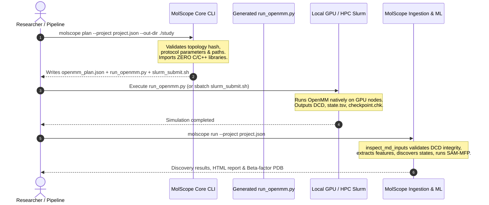
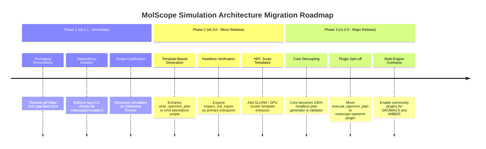

# Architectural Scope Review: Molecular Dynamics Simulation in MolScope

**Document Reference:** `docs/dev/scope-review.md`  
**Author:** Agent H — Architecture & Scope Review Specialist (Advisory Only)  
**Status:** Advisory Architecture Document  
**Date:** November 2026  
**Target Repository:** `molscope` (`https://github.com/N-S8990/molscope`)  

---

## Executive Summary

MolScope is architected as a **system-aware molecular-dynamics feature discovery, conformational state discovery, and ML prioritization platform**. Its core value proposition lies in biophysical feature extraction (contacts, dihedrals, secondary structure, PLIF), statistical state modeling (PCA, CKPCA, TICA, DPA, GMM), multi-objective Pareto ranking (SAM-MFP), and leakage-free cross-validation.

However, MolScope currently includes an embedded simulation engine module (`src/molscope/simulation/openmm.py`, ~433 LOC) and associated CLI entry points (`molscope plan`, `molscope simulate`, and the 3-stage `molscope run-pdb`). This module handles:
1. **Simulation Plan Generation**: Declarative generation of `openmm_plan.json` and standalone runner `run_openmm_plan.py`.
2. **Pre-flight Plan Inspection**: Dry-run validation, disk space estimation, and output collision checks.
3. **OpenMM Execution**: Automated energy minimization, Langevin equilibration, production MD, and checkpoint-backed trajectory generation.
4. **Trajectory Segment Recovery**: Hash-verified restart into immutable segmented directories.

This review assesses whether simulation generation and execution should:
- **Remain in core `molscope`** as a native convenience module;
- **Move to an optional package/plugin** (`molscope[simulation]` or `molscope-openmm`); or
- **Be reduced to an input plan validator and template generator** without internal execution capabilities.

### Strategic Verdict & Recommendation Summary

| Architectural Option | Strategic Fit | Maintenance Risk | Packaging Viability | Recommendation |
| :--- | :---: | :---: | :---: | :--- |
| **Option 1: Core Native Module** (Status Quo) | Low | High | Poor (git dependency) | **Discouraged** (Technical debt & packaging blocker) |
| **Option 2A: Optional Extra (`molscope[simulation]`)** | Moderate | Medium | Acceptable (with fixes) | **Recommended for Short-Term (v0.2.x - v0.3.0)** |
| **Option 2B: Dedicated Plugin (`molscope-openmm`)** | High | Low (for Core) | Good | **Recommended for Long-Term (v1.0.0)** |
| **Option 3: Plan Generator & Ingest Validator (Zero Execution)** | Highest | Lowest | Excellent | **Target Architecture for Core Platform** |

**Primary Advisory Recommendation:**
Adopt a **Two-Stage Decoupling Roadmap**:
1. **Immediate Phase (v0.2.x - v0.3.0)**: Retain the simulation capabilities strictly behind the optional extra `molscope[simulation]`, immediately remediating the fatal PyPI packaging obstacle (`pdbfixer @ git+...`), while isolating all simulation dependencies behind lazy imports.
2. **Target Evolution (v0.3.x - v1.0.0)**: Transition MolScope core to a **Headless Plan Generator & Trajectory Ingestion Platform (Option 3)**, spinning off the execution runner into a dedicated optional plugin `molscope-openmm` (or standalone script templates). In this model, MolScope core defines the protocol schema, generates deterministic, reviewable run scripts (for OpenMM, GROMACS, or SLURM), and validates generated trajectories on ingestion, but leaves physical MD integration to dedicated computational engines.

---

## 1. Architectural Review of Status Quo

### 1.1 Structural Inventory

The simulation capability in MolScope currently spans five components:

```
src/molscope/
├── core/
│   └── project.py              # OpenMMSimulationSpec, SystemSpec.simulation_protocol, _openmm_protocol()
├── simulation/
│   ├── __init__.py
│   └── openmm.py               # build_openmm_plan(), write_openmm_plan(), inspect_openmm_plan(),
│                               # execute_openmm_plan(), _prepare(), _resume_job()
├── cli/
│   ├── generate_openmm_plan.py # `molscope plan`
│   ├── run_pdb.py              # `molscope run-pdb` (Stage 1: OpenMM -> Stage 2: Clustering -> Stage 3: ML)
│   ├── check_environment.py    # Runtime check for openmm and pdbfixer
│   └── main.py                 # Commands: 'plan', 'simulate', 'run-pdb'
└── io/
    └── validation.py           # inspect_md_inputs() verifying trajectory integrity post-simulation
```

### 1.2 Separation of Concerns Analysis

The implementation inside `src/molscope/simulation/openmm.py` exhibits commendable design hygiene in its functional layering:

```mermaid
flowchart TD
    subgraph Core MolScope (Zero Simulation Dependencies)
        A[ProjectSpec / SystemSpec] -->|Declarative Protocol| B[build_openmm_plan]
        B -->|Pure JSON Serialization| C[openmm_plan.json]
        B -->|Python Template| D[run_openmm_plan.py]
        C --> E[inspect_openmm_plan / Dry-Run]
        E -->|Status / Disk Byte Estimates| F[Reviewable Plan State]
    end

    subgraph Execution Layer (Heavy Runtime Required)
        F -->|--run Authorization| G[execute_openmm_plan]
        G -->|_runtime_dependencies| H[import openmm, pdbfixer]
        H --> I[PDBFixer Preparation & Protonation]
        I --> J[OpenMM System & Langevin Integrator]
        J --> K[Production Run & DCD/State/Checkpoint Reporters]
        K --> L[Segment Checkpoint Recovery]
    end

    subgraph Ingestion & Feature Discovery
        K --> M[_validate_outputs_and_write_project]
        M --> N[inspect_md_inputs - MDAnalysis]
        N --> O[analysis_project.json]
        O --> P[Feature Extraction & SAM-MFP]
    end
```

Key architectural observations:
1. **Strict Lazy Loading**: `openmm`, `openmm.app`, `openmm.unit`, and `pdbfixer` are imported solely inside `_runtime_dependencies()` when `execute_openmm_plan()` is called. Calling `build_openmm_plan()`, `write_openmm_plan()`, or `inspect_openmm_plan()` incurs zero import-time overhead and functions in environments devoid of OpenMM.
2. **Explicit Execution Gate**: By design, `openmm.py` refuses to execute without an explicit `--run` flag. A user or pipeline must review with `--dry-run` or inspect the plan JSON before execution commences.
3. **Deterministic Output Scoping**: The engine enforces strict isolation: all simulation outputs must be child paths of `generated_output_root` and cannot collide with existing inputs or prior runs.
4. **Resumable Segments**: Recovery via `_resume_job` cryptographically validates parent PDB, system XML, and checkpoint files, writing resumed trajectories to isolated UUID segments.
5. **Coupling in `run-pdb`**: Unlike `molscope plan` and `molscope simulate`, `src/molscope/cli/run_pdb.py` creates tight coupling. It executes `build_openmm_plan()` immediately followed by `execute_openmm_plan()`. If OpenMM or PDBFixer is absent, this marquee command fails with a runtime exception.

---

## 2. Evaluation of Trade-Offs & Pressures

### 2.1 Dependency Footprint & Packaging Bottlenecks

The inclusion of an embedded MD engine imposes significant packaging and distribution friction:

#### A. The Direct Git Dependency Blocker (PEP 508 / PyPI Compliance)
In `pyproject.toml`, MolScope currently specifies:
```toml
[project.optional-dependencies]
simulation = ["openmm>=8.1", "pdbfixer @ git+https://github.com/openmm/pdbfixer.git"]
```
> [!CAUTION]
> **PyPI Upload Disallowance**: Direct URL / VCS references (e.g. `@ git+https://...`) are strictly forbidden by PyPI upload policies (PEP 440 & PEP 508). Any attempt to build standard source distributions or wheels for PyPI publication (`python -m build && twine upload dist/*`) will be rejected by the package index.

While PDBFixer has releases on PyPI (`pdbfixer>=1.9`), its maintainers historically lagged in releasing binary wheels or updates compatible with bleeding-edge Python versions (e.g. Python 3.12/3.13), forcing developers to rely on git references.

#### B. Native Binary & Accelerator Complexity
- **Platform Matrix**: OpenMM provides C++ extensions linked against hardware acceleration runtimes (NVIDIA CUDA, OpenCL, Apple Metal/Reference).
- **Distribution Fragmentation**: On PyPI, `pip install openmm` provides precompiled wheels for standard Linux, macOS, and Windows. However, CUDA-accelerated performance requires matching host NVIDIA driver versions and CUDA runtime toolkits, which are traditionally managed far more cleanly via Conda (`conda install -c conda-forge openmm`).
- **Build from Source Burden**: If binary wheels are unavailable (such as on specialized HPC clusters, ARM Linux, or custom Python builds), OpenMM requires CMake, SWIG, and a C++17 compiler, creating massive barrier-to-entry for non-expert users.

### 2.2 Scope Alignment vs Domain Overlap

#### A. The "Simulation Engine" Domain Trap
Building a reliable, general-purpose MD simulation engine is an enormous software undertaking. MolScope's current simulation engine (`openmm.py`) only supports:
- Implicit solvent (`amber14-all.xml`, `implicit/gbn2.xml`).
- A single non-bonded scheme (`NoCutoff` or basic cutoff).
- Standard protein residues (non-standard residues are forcibly replaced with standard equivalents or stripped).
- Stripping of crystallographic water molecules.

#### B. The Unparameterized Ligand Iceberg
In `openmm.py` (lines 268–278):
```python
if not protocol["keep_heterogens"]:
    fixer.removeHeterogens(False)
else:
    waters = [residue for residue in fixer.topology.residues() if residue.name in {"HOH", "WAT", "TIP3", "H2O"}]
    # deletes water, leaving non-protein heterogens
```
If a user submits a protein-ligand complex with `keep_heterogens: True`, OpenMM's standard force fields will throw a fatal `ValueError: No template found for residue <LIG>`.
To support general molecular simulations properly, an engine must integrate:
- Small molecule parameterization (OpenFF Toolkit, AmberTools `antechamber`, GAFF2, AM1-BCC charges);
- Explicit water box solvation (TIP3P, OPC, TIP4P-Ew) with periodic boundary conditions;
- Ion neutralization (NaCl/KCl to target physiological ionic strength, e.g. 0.15 M);
- Membrane embedding (POPC bilayers via CHARMM-GUI / packmol-memgen).

**Conclusion**: If MolScope retains native simulation execution, it will either:
1. Remain a toy implicit-solvent tool that fails on realistic drug discovery systems (protein-ligand, membrane proteins, metalloproteins); or
2. Suffer severe scope creep, requiring thousands of lines of molecular mechanics setup code that merely replicates existing tools like **OpenMM-Setup**, **HTMD**, **CHARMM-GUI**, or **BioBB**.

#### C. Overlap with Existing Mature Scientific Ecosystems
Computational biology groups already possess established, highly optimized simulation protocols:
- **GROMACS** (`gmx grompp`, `gmx mdrun`): The de facto HPC workhorse across national supercomputing facilities.
- **AMBER** (`pmemd.cuda`): Gold standard for implicit solvent and free energy perturbation.
- **OpenMM Native Scripts**: Custom Python scripts leveraging OpenFF, custom collective variables, and Deep Learning potentials (ANI, TorchMD-NET, MACE-OFF).

MolScope does not need to duplicate simulation engines. Its true research differentiation is what happens **after** the simulation: discovering cryptic conformational states, calculating unbiassed multi-objective feature importances, and ranking biophysical contacts with regularized statistical models.

### 2.3 User Convenience vs Maintenance Overhead

The fundamental argument for keeping simulation in core is **User Convenience**:
- **The "One-Liner" Quickstart**: `molscope run-pdb --pdb 1ubq.pdb --out-dir run1` allows a new user, a bioinformatician, or a machine learning researcher without MD experience to experience the entire pipeline in under two minutes without finding or formatting external trajectories.
- **Reproducible Integration Testing**: Synthetic integration tests (`tests/integration/test_openmm_simulation_pipeline.py`) can generate small, valid 4-frame coordinate trajectories dynamically in 15 seconds, verifying that the ingestion, clustering, and ML pipelines function on realistic coordinate files without checking huge binary DCD files into git.

However, the **Maintenance Overhead** is substantial:
- Maintainers must triage user issues related to CUDA driver incompatibilities, OpenMM installation failures, and physics explosions (NaN coordinates, ring piercing).
- CI matrices must either run slow software-reference MD simulations or mock OpenMM execution.

---

## 3. Comprehensive Evaluation of Architectural Options

### Option 1: Retain in Core `molscope` as Native Convenience Module (Status Quo + Remediation)

In this model, `src/molscope/simulation/openmm.py` remains in the primary repository, maintaining `molscope plan`, `molscope simulate`, and `molscope run-pdb`.

#### Structural Adjustments Required
1. Remove `pdbfixer @ git+...` from `pyproject.toml` and replace with a standard PyPI version specifier (`pdbfixer>=1.9`) or require Conda installation.
2. Explicitly document that native simulation is a **"Reference Prototyping Engine"** limited to monomeric implicit-solvent proteins.
3. Harden `molscope run-pdb` so that if OpenMM is absent, it prints an actionable installation guide rather than a raw Python stack trace.

#### Cost & Feasibility
- **Engineering Effort**: Very low (1–2 days).
- **Core Package Size**: Negligible code size (~450 LOC), but introduces heavy optional dependencies.
- **Long-term Maintenance**: High. Maintainers must track OpenMM/PDBFixer version compatibility and support simulation failures.

---

### Option 2: Decouple into an Optional Package or Plugin Ecosystem

This option moves simulation out of the default runtime into an explicit, decoupled boundary.

#### Sub-Option 2A: Optional Extra (`molscope[simulation]`) with Strict Boundary
- Code remains in `src/molscope/simulation/openmm.py`.
- Base `pip install molscope` installs zero simulation dependencies.
- `pip install molscope[simulation]` installs `openmm` and `pdbfixer`.
- If an unconfigured user invokes `molscope simulate` or `molscope run-pdb`, the CLI exits with:
  ```
  Error: Simulation execution requires the 'simulation' extra.
  Install it with: pip install 'molscope[simulation]' or conda install -c conda-forge openmm pdbfixer
  Alternatively, supply pre-computed trajectories to 'molscope run'.
  ```

#### Sub-Option 2B: Dedicated Standalone Plugin (`molscope-openmm`)
- Extract `src/molscope/simulation/` into a separate repository and PyPI package: `molscope-openmm`.
- MolScope core defines a lightweight `SimulationEngine` protocol interface or entrypoint in `src/molscope/core/engine.py`.
- `molscope-openmm` registers itself via Python `entry_points`:
  ```toml
  [project.entry-points."molscope.engines"]
  openmm = "molscope_openmm.engine:OpenMMEngine"
  ```
- `molscope run-pdb` checks for an installed simulation plugin. If none is found, it directs the user to install `molscope-openmm`.

#### Cost & Feasibility
- **Engineering Effort**:
  - Sub-Option 2A: Low (2–3 days).
  - Sub-Option 2B: Moderate (1–2 weeks, multi-repo CI/CD setup).
- **Core Package Size**: Clean, lightweight.
- **Long-term Maintenance**: Low for core repository; simulation issues are isolated to the plugin.

---

### Option 3: Reduce Core to an Input Plan Validator & Template Generator (Zero-Execution Core)

In this model, MolScope core completely abandons native execution of molecular dynamics. It becomes a **Headless Plan Generator and Ingestion Validator**.



#### Operational Workflow
1. **Plan Generation (`molscope plan`)**: MolScope core evaluates `OpenMMSimulationSpec` and generates:
   - `openmm_plan.json`: Portable metadata and configuration.
   - `run_openmm.py`: A clean, readable, standalone Python script using standard OpenMM API calls.
   - Optional `slurm_job.sh`: HPC cluster submission script with GPU parameters.
2. **External Execution**: The user executes `run_openmm.py` wherever their compute resources reside (local workstation with CUDA, cloud instance, or national supercomputing cluster via SLURM).
3. **Execution Integrity & Ingestion (`molscope validate` / `molscope run`)**: Once completed, MolScope’s existing `inspect_md_inputs()` verifies coordinate integrity, atom count matching, and writes `analysis_project.json`.

#### Cost & Feasibility
- **Engineering Effort**: Low-to-moderate (removes ~250 LOC of execution logic; replaces it with clean Jinja2/string templating for `run_openmm.py`).
- **Core Package Size**: Ultra-lean, zero native dependencies, 100% pure Python.
- **Long-term Maintenance**: Minimal. MolScope maintainers are no longer responsible for GPU drivers, OpenMM version shifts, or runtime simulation physics.

---

## 4. Comparative Evaluation Matrix

| Evaluation Dimension | Option 1: Native In-Core | Option 2A: Optional Extra (`molscope[simulation]`) | Option 2B: Separate Plugin (`molscope-openmm`) | Option 3: Headless Plan Gen & Ingest Validator |
| :--- | :---: | :---: | :---: | :---: |
| **PyPI Distribution Viability** | ⚠️ Fragile (fails with git deps) | ✅ Viable (clean PyPI spec) | ✅ Excellent | ✅ Pristine (Pure Python) |
| **Zero-Setup Quickstart (`run-pdb`)** | ⭐ Seamless | ⭐ Seamless (if extra installed) | 🟡 Requires installing plugin | ❌ Broken (requires 2 steps) |
| **HPC / Supercomputer Alignment** | ❌ Poor (runs in CLI process) | ❌ Poor | 🟡 Moderate | ⭐ Ideal (matches SLURM/batch) |
| **Scope Boundary Purity** | ❌ Blurs Analysis vs MD | 🟡 Acceptable boundary | ✅ Clean boundary | ⭐ Perfect domain separation |
| **Maintenance Burden on Core Team** | ❌ Heavy (MD helpdesk) | 🟡 Moderate | ✅ Low (isolated repo) | ⭐ Minimal |
| **Support for Large / Complex Systems** | ❌ Toy/Implicit only | ❌ Toy/Implicit only | 🟡 Can grow independently | ⭐ User controls OpenMM script |
| **CI / Integration Test Speed** | 🟡 Slower (runs real MD) | 🟡 Slower in `[all]` | ✅ Fast in core CI | ⭐ Blazing fast (validates plans) |

---

## 5. Strategic Recommendations & Actionable Roadmap

### 5.1 Recommendation

The optimal path for MolScope is **not** a sudden break that immediately destroys the `molscope run-pdb` convenience, but a **deliberate phased transition**:

1. **Short Term (v0.2.x - v0.3.0)**: Formalize **Option 2A (`molscope[simulation]`)**. Clean up `pyproject.toml` to eliminate git dependencies, enforce rigorous lazy-import boundaries, and brand the native simulation runner as a "Reference Prototyping Runner".
2. **Long Term (v0.3.x - v1.0.0)**: Evolve towards **Option 3 + Plugin Interface**. Make MolScope primarily a world-class Trajectory Ingestion, Feature Discovery, and ML Prioritization suite. Elevate Plan Generation to output self-contained, customizable scripts that users can run anywhere.

---

### 5.2 Phase-by-Phase Migration Path



#### Phase 1: Packaging Remediation & Strict Optional Boundary (Immediate v0.2.1)
*Goal: Restore standard PyPI build compliance without breaking existing user workflows.*
1. **Remediate `pyproject.toml`**:
   - Replace `"pdbfixer @ git+https://github.com/openmm/pdbfixer.git"` with `"pdbfixer>=1.9"`.
   - Ensure `pip install molscope` installs only core dependencies (`MDAnalysis`, `scikit-learn`, `numpy`, `pandas`, `scipy`, `networkx`, `plotly`, `tqdm`).
   - Retain `[project.optional-dependencies] simulation = ["openmm>=8.1", "pdbfixer>=1.9"]`.
2. **Friendly CLI Guardrails**:
   - In `src/molscope/cli/run_pdb.py` and `src/molscope/cli/main.py`, catch `ImportError` when OpenMM is missing and display a clear, structured notice:
     ```
     [MolScope] 'molscope run-pdb' requires OpenMM simulation capabilities.
     To enable native simulation, install:
         pip install 'molscope[simulation]'
     or via conda-forge:
         conda install -c conda-forge openmm pdbfixer
     
     If you already have trajectories, use the core analysis workflow:
         molscope run --project your_project.json --out-dir ./output
     ```
3. **Scientific Documentation Positioning**:
   - Update `docs/scientific-methods/openmm-simulation-guide.md` and `README.md` to clarify that MolScope's embedded OpenMM runner is intended for **reference benchmarking, smoke testing, and pedagogical examples (implicit solvent standard proteins)**, and that production drug-discovery campaigns should supply trajectories generated from specialized workflows (explicit solvent, AMBER, GROMACS, Desmond).

#### Phase 2: Enhanced Standalone Script & HPC Generation (v0.3.0)
*Goal: Empower users to run simulations outside the MolScope Python process.*
1. **Self-Contained Runner Generation**:
   - Upgrade `write_openmm_plan()` so that `run_openmm_plan.py` is completely self-contained (does not import `molscope.openmm_plan`). It should be a standalone, 80-line pure OpenMM script that can be copied to any remote GPU cluster or Google Colab instance without installing MolScope.
2. **Cluster Template Support**:
   - Introduce `--slurm` flag to `molscope plan`, outputting a `submit_openmm.sh` SLURM batch script with GPU partition, walltime, and environment setup placeholders.
3. **Formal Ingestion API**:
   - Promote `molscope.io.validation.inspect_md_inputs()` to a user-facing CLI command: `molscope ingest --topology prepared.pdb --trajectory trajectory.dcd --out-dir ./study`, automatically bootstrapping `project.json`.

#### Phase 3: Core Decoupling & Plugin Architecture (v1.0.0)
*Goal: Pure architectural separation of analysis vs molecular simulation.*
1. **Core Package Purity**:
   - Remove `execute_openmm_plan()` and `_runtime_dependencies()` from `molscope` core.
   - Core maintains `molscope.simulation.planning` (pure Python plan generation and validation).
2. **Spin Off `molscope-openmm`**:
   - Publish `molscope-openmm` as an optional extension package providing direct in-process execution for users who still desire the unified `molscope run-pdb` one-liner.
3. **Extensibility for Other Engines**:
   - The same planning and validation framework can naturally accommodate community plugins: `molscope-gromacs` (generating `.mdp` files and `gmx` wrappers) and `molscope-amber` (generating `sander`/`pmemd` input decks).

---

## 6. Cost & Risk Analysis

| Action | Technical Risk | Maintenance Cost | Ecosystem Impact | Mitigation Strategy |
| :--- | :--- | :--- | :--- | :--- |
| **Do Nothing (Keep in Core as is)** | **High**: PyPI releases blocked; user issues on complex topologies. | High ongoing triage. | Negative: Confuses scope of tool. | Must at least fix the git dependency in `pyproject.toml`. |
| **Phase 1: Optional Extra (`[simulation]`)** | **Very Low**: Backwards-compatible; purely additive. | Moderate: Retains existing tests and code. | Positive: Restores standard packaging compliance. | Comprehensive CI test matrix testing both with and without `[simulation]`. |
| **Phase 2: Self-Contained Script Templates** | **Low**: Additive functionality. | Low: Minimal template maintenance. | Highly Positive: Bridges laptop prototyping to HPC production. | Unit-test generated Python scripts against OpenMM syntax. |
| **Phase 3: Full Decoupling into Plugin** | **Moderate**: Requires multi-repo maintenance if spun into separate package. | Lowest for core; moderate for plugin. | Highly Positive: Establishes MolScope as an unencumbered ML/analysis standard. | Provide unified meta-package or comprehensive docs for quickstart users. |

---

## 7. Conclusion & Next Steps

Molecular dynamics simulation execution is fundamentally compute-heavy, hardware-specific, and platform-dependent, whereas feature discovery, conformational state discovery, and ML prioritization are data-driven, analytical, and hardware-agnostic.

By transitioning MolScope from an **accidental simulation runner** to a **first-class Plan Generator, Trajectory Ingestor, and Biophysical Feature Prioritization Engine**, the project preserves its pedagogical convenience (via `molscope[simulation]`) while aligning its architecture with real-world computational chemistry workflows.

Maintainers are advised to approve **Phase 1** for the upcoming release to resolve packaging compliance, followed by scheduling **Phase 2** for the subsequent feature cycle.
